# LiteTavern

<p align="center">
  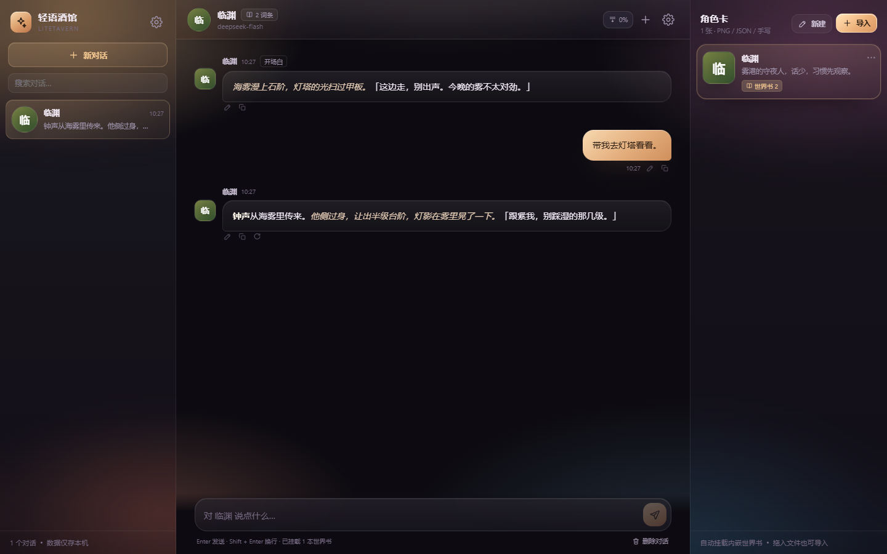
</p>

<p align="center">
  A tiny, local-first client for SillyTavern character cards and world books — Windows &amp; Android.
</p>

<p align="center">
  <a href="LICENSE"></a>
  <a href="https://github.com/nanwu98/lite-tavern/releases"></a>
  <a href="https://github.com/nanwu98/lite-tavern/actions/workflows/ci.yml"></a>
  <a href="README.md">简体中文</a> · English
</p>

---

## What it is

Import a SillyTavern character card (PNG or JSON), get its embedded world book
mounted automatically, pick the card and start chatting. No card marketplace, no
group chat, no plugin store, no cloud sync — just the story.

- Three columns: conversations on the left, chat in the middle, cards on the right.
- Everything is stored locally; the API key never leaves your machine except as
  an `Authorization` header to the endpoint you configure.
- Built-in streaming client for DeepSeek, Qwen, Zhipu, Kimi, ERNIE, Hunyuan,
  Doubao, SiliconFlow and any other OpenAI-compatible endpoint, including your
  own gateway.

## Features

- **Cards**: import PNG / JSON (`chara_card_v2/v3` and legacy flat cards), or
  **create one by hand** with just an avatar, name, note, system prompt and
  opening message. Imported cards can be edited later, and the start screen lists
  every card with a **✕** that deletes it after a confirmation.
- **World books**: auto-mounted from the card; import, **create by hand**, and
  add/edit/delete entries inside the app. Imported world books are editable too.
- **Openings and versions**: `first_mes` + `alternate_greetings` become swipeable
  openings; regenerating an AI reply adds a new variant instead of overwriting;
  any message in the history can be edited and the edited text is what the model
  receives.
- **Context compaction (since 1.4.0)**: long chats fold the oldest messages into
  a rolling "story memory", so only the memory plus the recent messages are sent.
  Settings has **auto compaction** (triggers at 80% of the configured window), the
  chat header shows current usage, and a reply rejected with
  `context_length_exceeded` gets a **compact and continue** button that runs the
  same summarizer and retries.
- **Backup & restore**: Settings → Backup & restore, pick cards (with their world
  books) and/or chat history, and export a timestamped JSON file. Import the same
  file on another machine or after a reinstall — Windows and Android backups are
  interchangeable, and imports merge instead of overwriting.
- **Card code (since 1.1.0)**: HTML/JS written for Tavern Helper / JS-Slash-Runner
  runs in an isolated iframe — character creation forms, status bars, floating
  windows and MVU variable updates work. Can be disabled in Settings.
- **Look**: dark / light / follow the system, with a "warm dusk glass" interface:
  a layered aurora background, frosted panels, soft glows and restrained motion.
  Older WebViews automatically fall back to opaque panels.
- **Boss key (desktop)**: a configurable global shortcut hides and restores the
  window.
- **Model providers (1.6.0+, picker rebuilt in 1.6.4)**: pick a provider from a
  dropdown and the Base URL, suggested models, context window and API-key page are
  filled in for you; keys are remembered per provider, and "Custom" accepts any
  OpenAI-compatible endpoint. **Fetch latest models** calls the provider's
  `/models` endpoint and lists what your key can actually use, with a search box;
  the model id stays editable. Streaming, temperature, context length and
  world-book budget are adjustable.
- **Chat settings (1.6.4+, card background in 1.6.5)**: every conversation has its own
  title, context window (follow global / 64K / 128K / 256K / 1M / custom) and background
  picture (uploaded, downscaled to 1920 px; dark mode adds a very light dark veil, light
  mode does not). You can also tick **use the card picture as the background**: a PNG
  card's avatar then doubles as the backdrop, while a JSON card (no picture) leaves the
  option greyed out.
- **Layout (1.6.5+)**: both desktop side panels collapse to the window edge, leaving a
  slim handle to bring them back, and the choice is remembered. The card menu (⋯) is a
  proper overlay that closes on an outside click.
- **Quoted dialogue (1.6.8+)**: text inside `""`, `“”`, `«»`, `「」`, `『』` or `＂＂` is
  tinted warm orange in both AI and user messages, following SillyTavern's rule; quotes
  inside code blocks are left alone.
- **Your own avatar (1.6.8+)**: Settings → Roleplay → under your name you can upload,
  replace or remove an avatar. Once set, your messages show it next to the bubble; with
  no avatar the layout stays exactly as before.
- **Pagination and paired entry points (1.6.9+)**: the start screen and the card rail are
  paginated (9 cards per page on desktop, 6 on phones; the rail shows 8), with themed
  prev/next controls. The start screen always keeps **Import** and **New** side by side at
  the same size, and opening the rail from a chat jumps to the page holding that card.
- **Swipe drawers on phones (1.6.9+)**: swipe left on the chat to open the card rail,
  right to open the chat list, and swipe the opposite way inside a drawer to close it.
  Vertical scrolling and horizontal code-block scrolling are unaffected.
- **Android power (1.6.9+)**: the full-screen aurora and other decorative loops are frozen
  on phones (same look). Idle CPU measured on a real device dropped from ~110% to 0–3%.
- **Pinning and archiving (1.7.0+)**: every row in the chat list now opens a three-dot
  menu with **Pin / Archive / Delete**. Pinned chats stay at the top; archived chats are
  hidden from the main list without being deleted, and **View archive** at the bottom
  shows their avatar, title and last-updated date with **Restore** and permanent delete.
  Deletion still asks once and cannot be undone.
- **Compact start screen (1.7.0+)**: the tagline under the title is gone, cards are smaller
  (no "start chatting" line) and the total count sits next to **Next**. On phones the chat
  list / cards / settings buttons live in a fixed top bar that content can no longer cover.
- **In-app updates (1.5.0+, silent check on launch since 1.6.4)**: the app checks
  for a release in the background at startup and lights a small red dot on the
  settings button when one exists; Settings → About & updates shows the version,
  its notes and the installer size, verifies the SHA-256 from the release
  manifest, then swaps the launcher and restarts (Windows) or opens the system
  package installer (Android, which still asks for confirmation).

## Screenshots

| Dark                  | Light                       |
| --------------------- | --------------------------- |
|  | 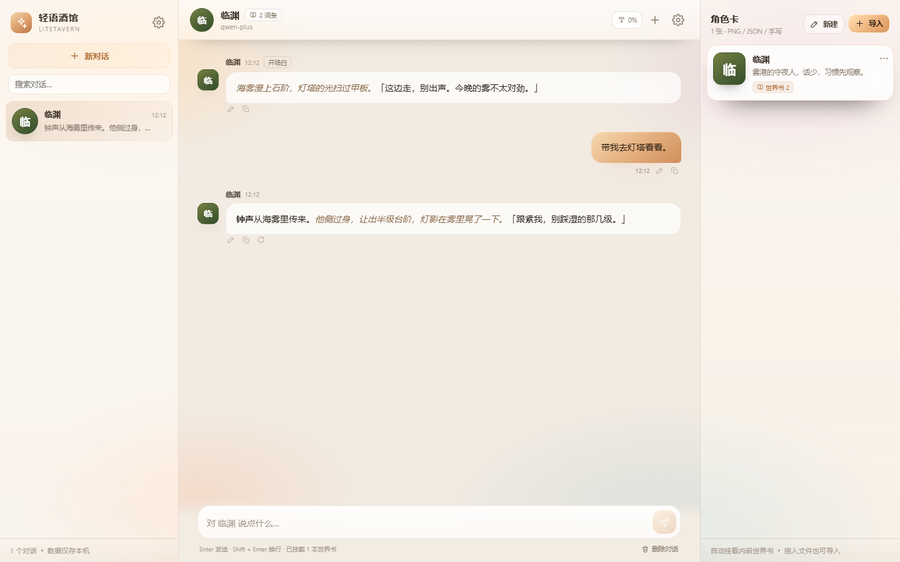 |

| Start screen          | Backup & restore     | World book editor              |
| --------------------- | -------------------- | ------------------------------ |
| 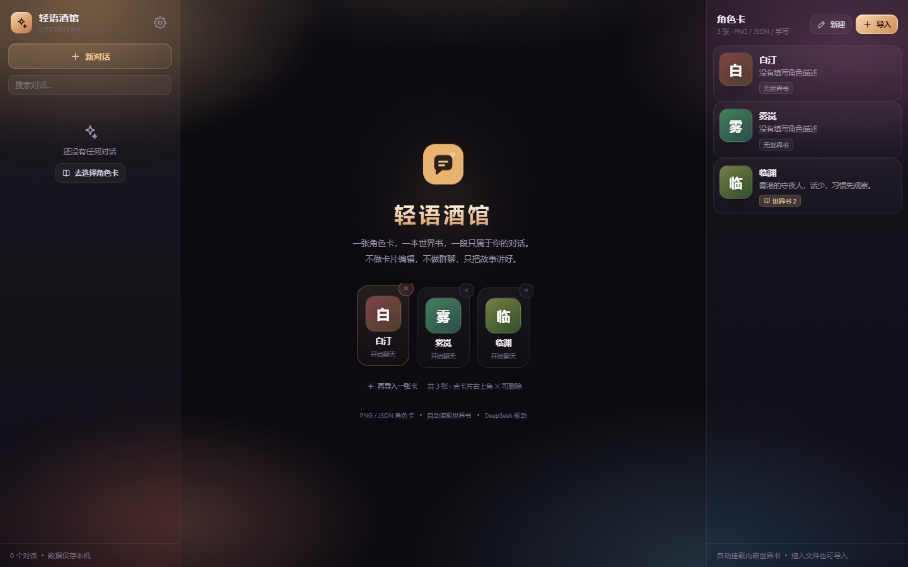 | 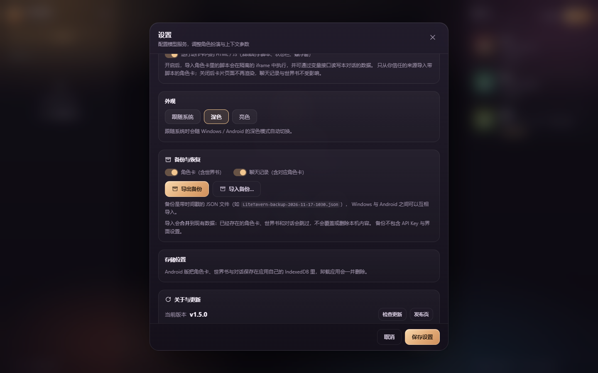 | 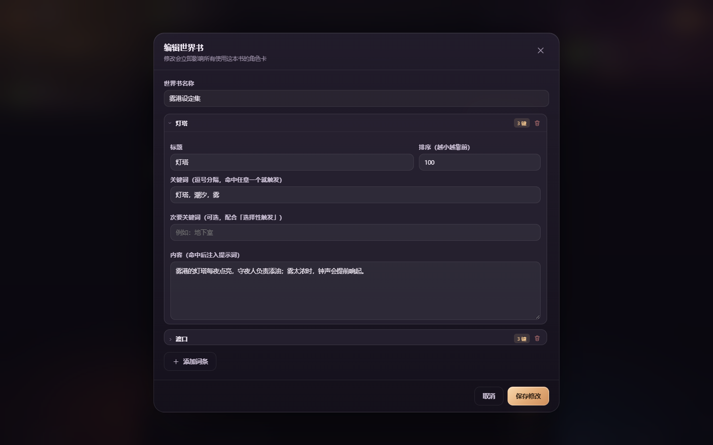 |

| Chat settings (1.6.4)       |
| --------------------------- |
| 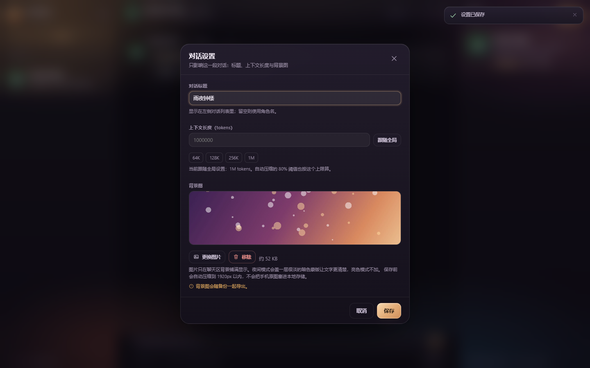 |

<p align="center">
  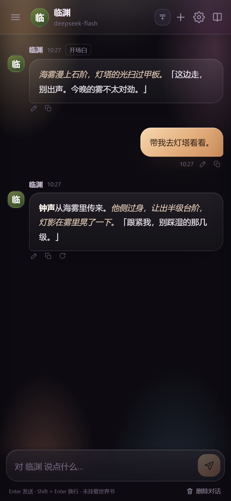
  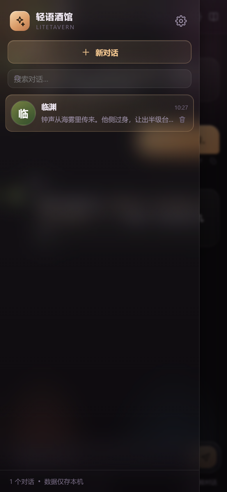
</p>

## Download and install

Grab the latest build from the repository's
[**Releases**](https://github.com/nanwu98/lite-tavern/releases) page:

- Windows 10/11 x64: `LiteTavern-<version>-win-x64.exe` — single file, extracts
  itself to `%LOCALAPPDATA%\LiteTavern\<version>` on first launch.
- Android 8.0+: `LiteTavern-<version>.apk` — signed, sideload-ready.

> Release binaries are signed with a local key; the repository contains no
> signing keys. See below to build your own.

### The unpacked `LiteTavern.exe`

On first run the single-file exe unpacks to `%LOCALAPPDATA%\LiteTavern\<version>\`
(or `LiteTavernData\<version>\` next to the exe when AppData is not writable) and
keeps cards, chats and settings in a sibling `UserData\` folder. **Launching the
unpacked `LiteTavern.exe` directly uses the same profile as the single-file exe**
since 1.4.0, because the unpacked build recognises the portable layout. Older
builds skipped that check and opened an empty `%APPDATA%` profile, which made an
existing library look lost.

Settings → Data location shows the current data folder and can open it. The
launcher also reuses an existing install location when upgrading, so cards are
never stranded in another directory.

## Build from source

Requires Node.js 22.13+ and pnpm 11.

```bash
pnpm install
pnpm dev          # dev server at http://localhost:5173
pnpm build        # type-check + bundle the web app
pnpm test         # unit tests
pnpm test:e2e     # Playwright end-to-end tests (starts a local mock model server)
```

### Windows single-file exe

```powershell
powershell -NoProfile -ExecutionPolicy Bypass -File scripts/build-windows.ps1
```

Output: `release/LiteTavern-<version>-win-x64.exe`. Requires .NET Framework 4.x
(shipped with Windows).

### Android APK

Requires JDK 17+ and the Android SDK (`platforms;android-34`,
`build-tools;34.0.0`). The script auto-detects `JAVA_HOME` / `ANDROID_HOME`.

```powershell
$env:LITE_TAVERN_KEYSTORE_PASS = 'your-signing-password'   # optional
powershell -NoProfile -ExecutionPolicy Bypass -File scripts/build-android.ps1
```

Signing keys are never committed:

- Without configuration the first build generates a local key at
  `android/lite-tavern.keystore` (default password `lite-tavern-dev`).
- Or configure `android/keystore.properties` (git-ignored) or the environment
  variables `LITE_TAVERN_KEYSTORE` / `LITE_TAVERN_KEYSTORE_PASS` /
  `LITE_TAVERN_KEY_ALIAS`.
- Keep and reuse the same key if you want to upgrade an installed APK in place.

### Publishing a release

```bash
node scripts/bump-version.mjs 1.5.0   # package.json + Android versionCode/versionName + launcher
# add a "## [1.5.0]" section to CHANGELOG.md (it becomes the release notes)
git commit -am "release: 1.5.0" && git tag v1.5.0 && git push origin main --tags
```

The `Release` workflow then builds the exe/APK, writes `version.json` (file name,
size and SHA-256 per platform) and creates the GitHub release. Automatic Android
builds need the `ANDROID_KEYSTORE_BASE64`, `ANDROID_KEYSTORE_PASS` and
`ANDROID_KEY_ALIAS` repository secrets; without them only the Windows build is
published and the APK can still be produced locally with `pnpm android:build`.

## Usage

1. Open Settings → **Model service**, pick a provider (or "Custom" and type a Base
   URL), enter the API key and model name, press "Test connection" and save.
2. On the right, **Import** a PNG/JSON card, or **New** to write one by hand.
3. Embedded world books mount automatically; use the card menu to import, create
   or edit world books.
4. Click a card to chat. `‹ 1/3 ›` under a message switches openings or
   regenerated variants; the pencil edits the history.
5. Switch dark / light / system themes in Settings; the desktop build also has a
   boss key.
6. The start screen (shown when no conversation is selected) lists every card;
   its **✕** asks for confirmation and then deletes the card with its chats.
7. Settings → Backup & restore: choose what to include, export a timestamped JSON
   file, and import it on another device.

### Supported model services

<p align="center">
  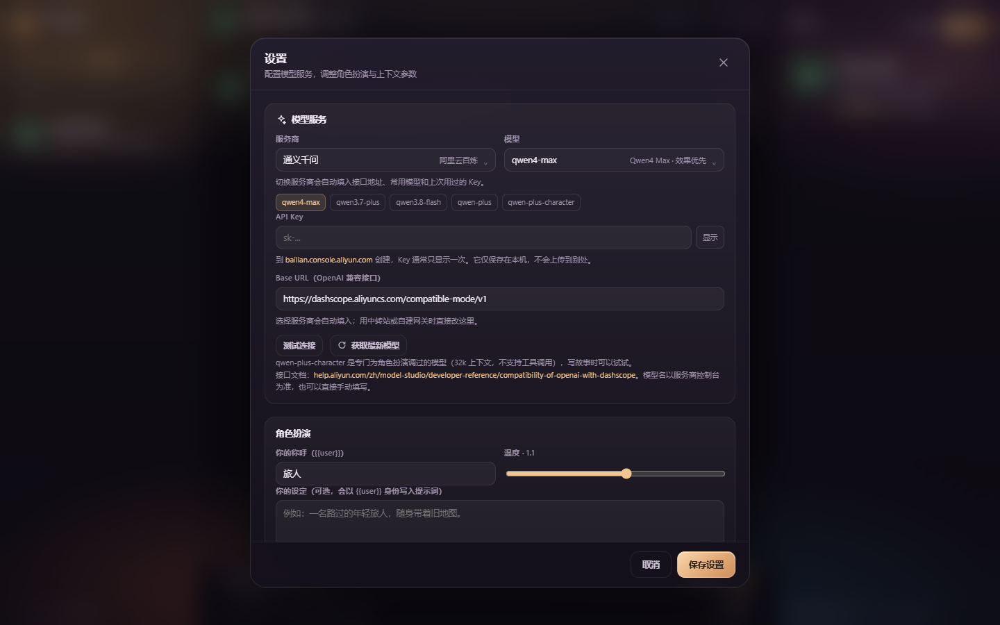
</p>

<p align="center">
  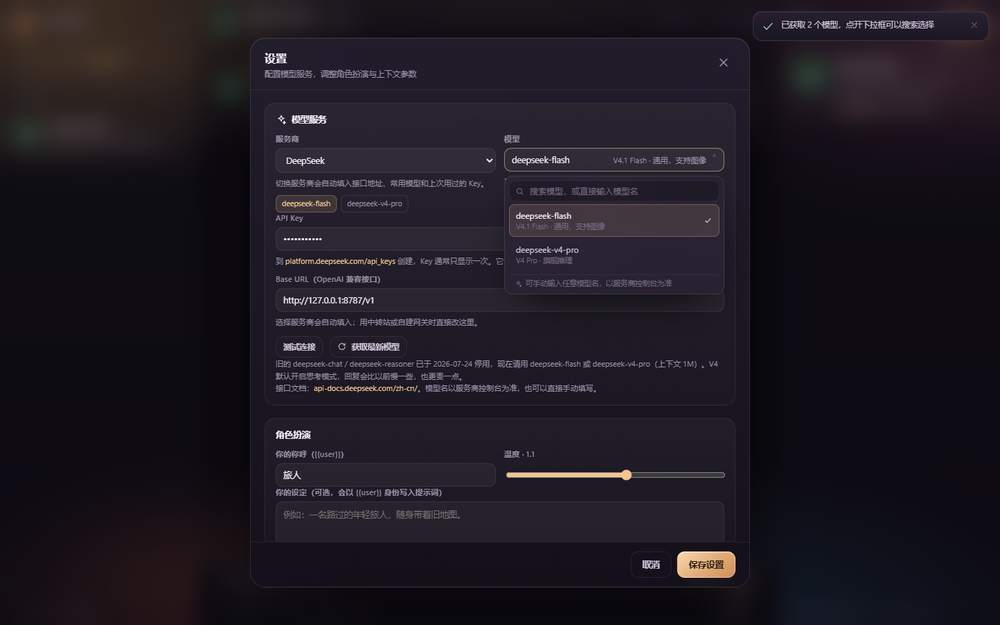
</p>

The provider dropdown fills in the Base URL, model suggestions and the page where
the API key is created. Model ids are suggestions only — the field stays editable,
and the provider console is the source of truth. **Fetch latest models** asks the
provider (`GET {Base URL}/models`) for what your key can really use and filters
out embeddings, rerankers and image/audio models.

| Provider                 | Base URL                                            | Example models                                                         |
| ------------------------ | --------------------------------------------------- | ---------------------------------------------------------------------- |
| DeepSeek                 | `https://api.deepseek.com`                          | `deepseek-flash` (V4.1) / `deepseek-v4-pro`                            |
| Qwen (Alibaba DashScope) | `https://dashscope.aliyuncs.com/compatible-mode/v1` | `qwen4-max` / `qwen3.7-plus` / `qwen3.8-flash` / `qwen-plus-character` |
| Zhipu GLM                | `https://open.bigmodel.cn/api/paas/v4`              | `glm-5.3` / `glm-5.3-flash` / `glm-5.3-flashx`                         |
| Kimi (Moonshot)          | `https://api.moonshot.cn/v1`                        | `kimi-k3.1-pro` / `kimi-k3.1-pro-highspeed` / `kimi-k3`                |
| ERNIE (Baidu Qianfan)    | `https://qianfan.baidubce.com/v2`                   | `ernie-5.1` / `ernie-5.0` / `ernie-x1.1`                               |
| Tencent Hunyuan          | `https://api.hunyuan.cloud.tencent.com/v1`          | `hunyuan-a13b` / `hunyuan-role-latest` / `hunyuan-turbos-latest`       |
| Doubao (Volcengine Ark)  | `https://ark.cn-beijing.volces.com/api/v3`          | `doubao-seed-evolving` / `doubao-seed-2-1-pro-260915` (or an `ep-…`)   |
| SiliconFlow              | `https://api.siliconflow.cn/v1`                     | `deepseek-ai/DeepSeek-V4-Pro` / `deepseek-ai/DeepSeek-V4.1-Flash`      |
| Custom                   | any OpenAI-compatible URL                           | per your provider                                                      |

> Model ids move fast: DeepSeek retired `deepseek-chat` / `deepseek-reasoner` on
> 2026-07-24, and 1.6.4 migrates a saved alias to `deepseek-flash` on launch.

### Checking for updates

<p align="center">
  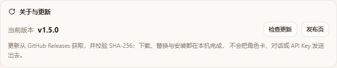
</p>

- The app checks for a new version silently on launch and lights a red dot on the
  settings button when one exists; the release notes are then already shown under
  About & updates, so there is no need to press "Check for updates" first.
- The version manifest is `version.json`, published as a release asset next to the
  installers and read through `releases/latest/download/...`, so it costs no
  GitHub API quota.
- If `github.com` is unreachable the request falls back to the `ghfast.top` and
  `ghproxy.net` mirrors; every download is checked against the SHA-256 in the
  manifest, and a mirror that rewrites the binary gets discarded.
- **Windows**: download → verify → replace the launcher (the previous file is
  renamed `.old` and cleaned up on the next start) → restart. Cards, chats and
  settings live in `UserData` and survive the upgrade.
- **Android**: download → verify → hand the APK to the system installer. The
  first time you must allow "install unknown apps" for LiteTavern; Android never
  installs silently, so the last step is always yours.
- The app only contacts the network when you press the button.
- 1.4.0 and older have no updater, so those builds need one manual install of
  1.5.0; after that both platforms update themselves.

### Backup and restore

- Backups are readable JSON named like `LiteTavern-backup-2026-11-17-1030.json`.
- **Windows and Android files are interchangeable** (unless a future format change
  is explicitly breaking).
- Desktop opens a native save dialog; Android writes to the app cache and opens
  the system share sheet (Files, Drive, WeChat, …).
- Importing **merges**: entries are deduplicated by id (and by name + creation
  time), so existing cards, books and chats are skipped rather than overwritten.
- Backups contain cards, world books (with entries), chats and compacted story
  memory — never the API key or settings.
- The app also keeps an unattended local snapshot of the newest data
  (`lite-tavern-autosave.json` in the data directory on desktop). If IndexedDB is
  damaged by a forced shutdown or power loss, the next launch restores from that
  snapshot and says so. Deleting every card clears the snapshot, so it never
  resurrects data you removed on purpose.

### Context compaction

- The percentage button in the chat header estimates the next request; open it to
  see the window, the auto-compaction threshold and the stored memory.
- Settings → Context compaction: set the model window (`64K / 128K / 256K`
  presets — check the provider docs) and enable **auto compaction**. At 80% of the
  window the oldest messages are summarized into memory before sending.
- With auto compaction off, a provider rejection (`context_length_exceeded`)
  renders a **compact and continue** button on the failed message; it runs the
  same summarizer and retries the turn.

### Chat settings

- The sliders icon in the chat header opens per-conversation settings.
- **Title**: shown in the conversation list and the chat header; empty falls back
  to the character name.
- **Context window**: follow the global setting, or give this one conversation its
  own 64K / 128K / 256K / 1M / custom value. The usage percentage and the 80%
  auto-compaction trigger both use it.
- **Background**: upload a picture; it is downscaled to 1920 px (JPEG q0.82) and
  fills the chat area. Dark mode adds a very light dark veil for legibility, light
  mode adds nothing. It can be removed at any time and travels with backups.
- **Use the card picture as the background**: the avatar then doubles as the backdrop and
  follows any later card edit. Only cards with a picture (PNG imports) can use it — a JSON
  card has no avatar, so the option is greyed out until you add one in "Edit card".

### Card code

Cards that ship Tavern Helper / JS-Slash-Runner code get a compatibility bridge
inside an isolated iframe: `TavernHelper`, `SillyTavern.getContext()`, variables,
events, `getChatMessages`, `triggerSlash`, `generateRaw`, `Mvu`, `z`, `YAML` and
more. Settings → Card code disables execution entirely.

## Data and privacy

- Cards, world books, chats and variables live in local IndexedDB. No account,
  no cloud sync, no telemetry.
- The API key is stored locally in plain text and is only sent to the Base URL
  you configure.
- Card scripts are arbitrary code: only import cards from sources you trust.

## Known limitations

- Card scripts that load from a CDN (MVU, pinia, …) need network access.
- EJS templates inside cards (`<%_ … _%>`) are not rendered and reach the prompt
  verbatim.
- The Tavern Helper API covers the common subset; audio, presets and world-book
  editing APIs are stubs.
- Card code on Android requires a reasonably recent System WebView (Chromium 89+,
  i.e. Android 11 or newer in practice).

## Development

```
src/                React UI, state, card and world-book logic
src/lib/tavern/     Tavern-Helper compatible script runtime (iframe bridge)
electron/           Electron main process and preload
android/            Capacitor Android project
scripts/            Build scripts and launcher source
tests/              Vitest unit tests and Playwright end-to-end tests
docs/               Screenshots used by the READMEs
```

Run `pnpm test` and `pnpm test:e2e` before submitting a change; see
[CONTRIBUTING.md](CONTRIBUTING.md).

## Intended use and compliance

**LiteTavern is an open-source, local learning tool — not an online service and not an AI
product.** These boundaries are also the design premises of the project:

- **A client only: no models, no content.** The project ships no model weights, inference
  service, cloud endpoint or proxy. Every request is made with your own API key, directly to
  the provider you choose (or your own gateway). The provider is the service operator; this
  project is the local UI that reads and writes your cards.
- **No cards, world books, presets or "jailbreak" prompts, and no card indexing or
  recommendation.** Everything inside the app is imported or written by the user. There are no
  bundled sample cards, no download links and no instructions for bypassing a provider's safety
  policy.
- **No operation, no hosting, no charging.** No accounts, no cloud sync, no telemetry, no paid
  tier: cards, world books and chats live only on your own device (local IndexedDB /
  `UserData`). The project collects, uploads and resells no user data.
- **Intended for adults, for technical learning and personal creative writing.** Users are
  responsible for the content they import, generate and share, and must ensure it complies with
  the laws of their jurisdiction. Do not use this project to create or distribute illegal,
  infringing or harmful material.
- **Distributed only as source code and GitHub Releases.** The project does not target app-store
  distribution and makes no listing or compliance promise for any region; check the legality of
  your use in your own jurisdiction first.

> Released under the MIT license, provided "as is", without warranty of any kind. The authors
> and contributors accept no liability for any consequence of using this project. This section
> describes the project's scope; it is not legal advice.

## Credits

- Card/world-book formats and regex semantics follow
  [SillyTavern](https://github.com/SillyTavern/SillyTavern).
- The card-script API mirrors
  [JS-Slash-Runner](https://github.com/N0VI028/JS-Slash-Runner) and
  [MagVarUpdate (MVU)](https://github.com/MagicalAstrogy/MagVarUpdate).
- Built with React, Vite, Zustand, Electron, Capacitor, marked, DOMPurify and
  other open-source projects, each under its own license.

## License

[MIT](LICENSE) © LiteTavern contributors
