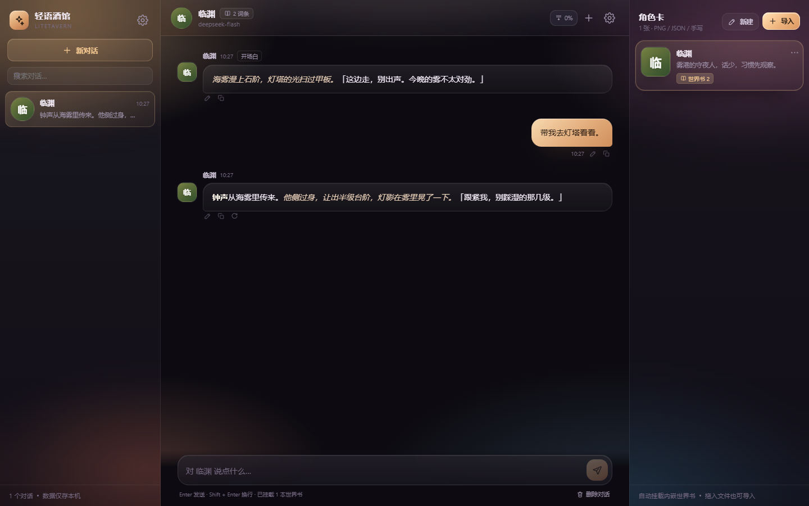
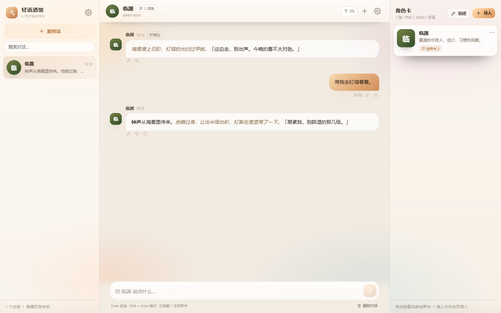
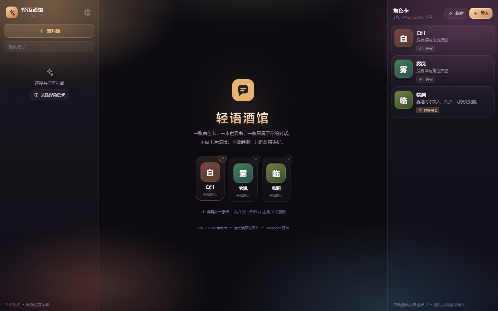
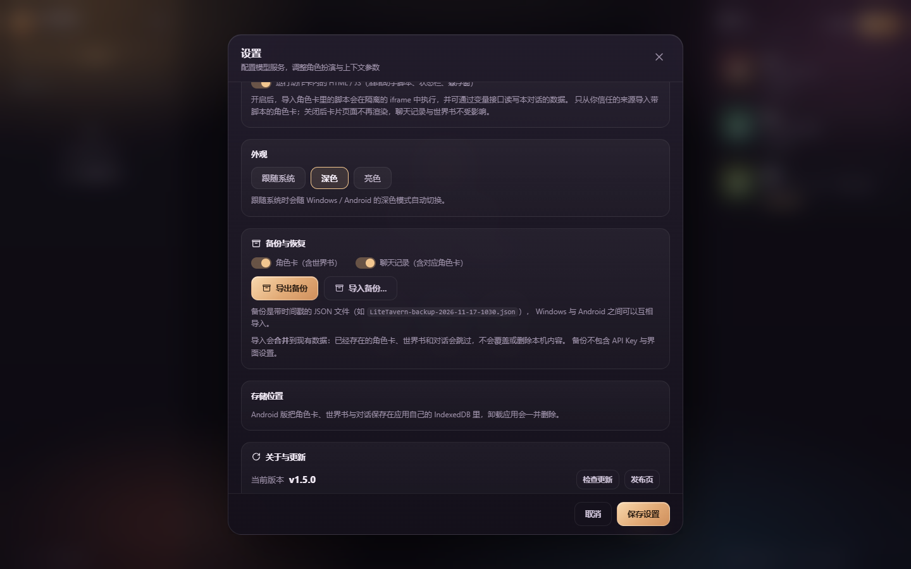
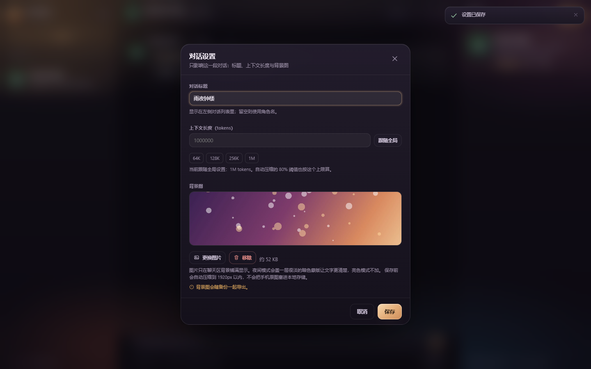
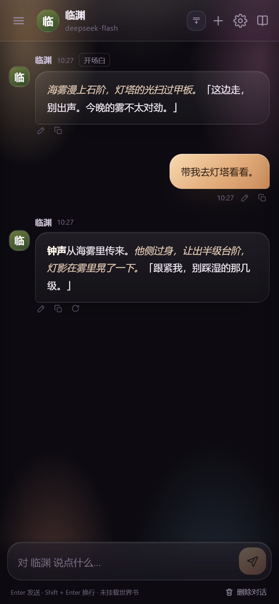
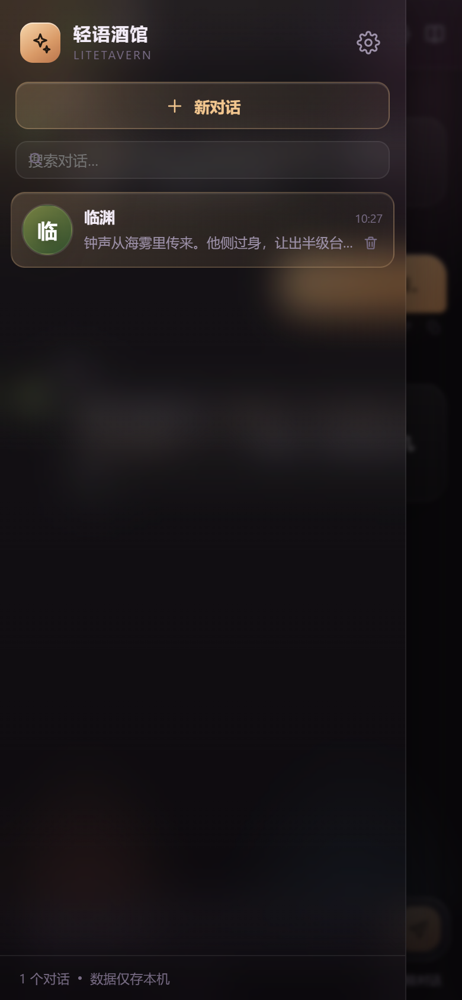
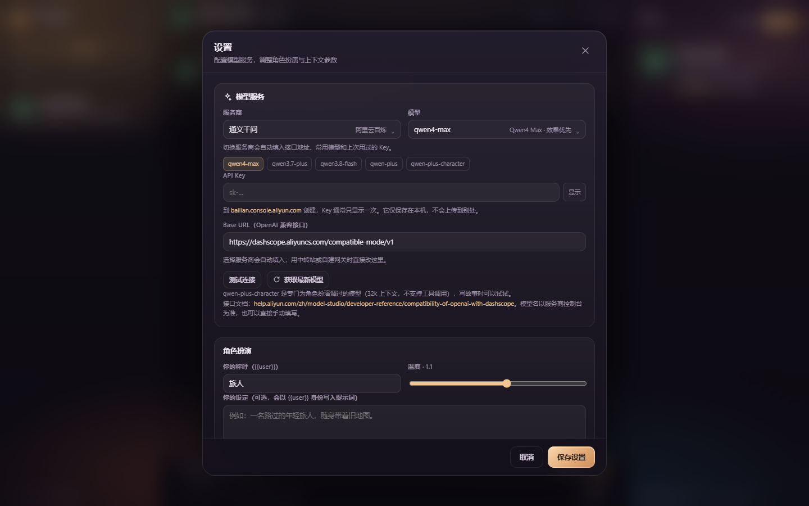
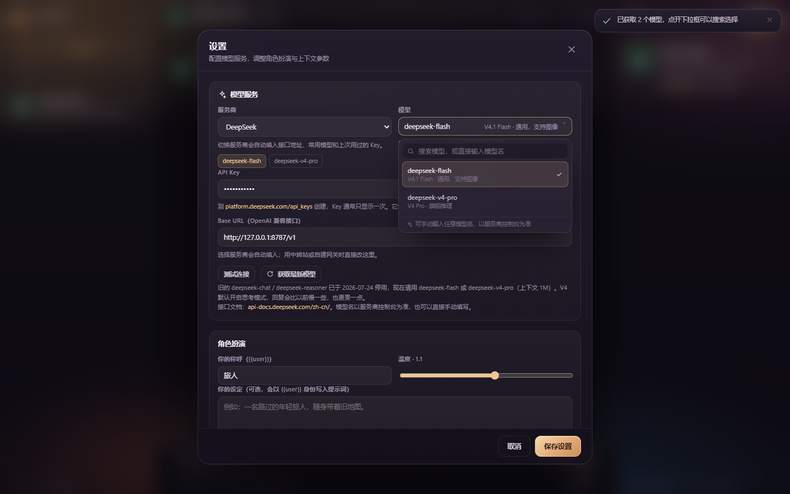

# 轻语酒馆 · LiteTavern

<p align="center">
  
</p>

<p align="center">
  只做「角色卡 + 世界书聊天」的极简本地客户端 · Windows / Android
</p>

<p align="center">
  <a href="LICENSE"></a>
  <a href="https://github.com/nanwu98/lite-tavern/releases"></a>
  <a href="https://github.com/nanwu98/lite-tavern/actions/workflows/ci.yml"></a>
  <a href="README.en.md">English</a> · 简体中文
</p>

---

## 这是什么

导入一张酒馆角色卡（PNG / JSON），卡内嵌的世界书会自动挂载，选一张卡就能开聊。
没有卡片编辑器（但可以手写）、没有群聊、没有插件市场、没有云同步——只把故事讲好。

- 左侧对话列表，中间聊天，右侧角色卡。
- 数据全部保存在本机；API Key 只存在本机，只发送到你填写的接口地址。
- 内置流式客户端，支持 DeepSeek、通义千问、智谱、Kimi、文心、混元、豆包、硅基流动等 OpenAI 兼容服务，也能接自建网关。

## 功能

- **角色卡**：导入 PNG / JSON（`chara_card_v2/v3`、旧版平铺格式），或**手动创建**一张卡，只填头像、名字、备注、系统提示词和开场白；已导入的卡也能随时编辑。启动页会列出本机全部角色卡，卡片右上角的 **✕** 二次确认后即可删除。
- **世界书**：随卡自动挂载；支持手动导入、**手动创建**、在应用内添加/修改/删除词条，以及编辑已导入的世界书。
- **开场白与版本**：`first_mes` + `alternate_greetings` 变成可左右切换的开场；重新生成 AI 回复会追加新版本而不是覆盖；用户和 AI 的历史消息都能直接编辑，修改后会作为真实历史发给模型。
- **上下文压缩（1.4.0 起）**：长对话会把最早的一批消息交给模型总结成一段「长期记忆」，之后只发送「记忆 + 最近几条消息」，省下大量上下文又不忘剧情。设置里可开**自动压缩上下文**（达到上限 80% 时自动触发），聊天头部也能看到当前用量并手动压缩；如果关掉自动压缩、真的被服务端以「上下文超限」拒绝，失败的消息里会出现**一键压缩上下文并继续对话**按钮，点一下就走同一套压缩流程。
- **备份与恢复**：设置 → 备份与恢复，勾选「角色卡（含世界书）」和/或「聊天记录（含对应角色卡）」，导出带时间戳的 JSON 备份；换设备或重装后导入同一个文件即可恢复。Windows 与 Android 之间互通，导入是**合并**而不是覆盖。
- **角色卡代码（1.1.0 起）**：卡里用酒馆助手 / JS-Slash-Runner 写的 HTML + JS 会在隔离 iframe 中运行——角色创建表单、状态栏、悬浮窗、MVU 变量更新都能工作。可在设置里整体关闭。
- **应用内更新（1.5.0 起，1.6.4 起启动时静默检查）**：打开应用会在后台查一次新版本，有更新时设置按钮右上角亮起**小红点**；设置 → **关于与更新** 直接展示版本号与更新说明，点下载即可。下载后先用清单里的 SHA-256 校验再安装——Windows 会替换启动器并自动重启，Android 会调起系统安装器（需要你确认一次）。
- **外观**：深色 / 亮色 / 跟随系统，「暖暮柔光玻璃」界面：分层极光背景、磨砂面板、柔和光晕与克制的入场动效；低配 WebView 会自动退回不透明的实色面板。Android 端为沉浸式：内容绘制到状态栏/导航栏后面，背景颜色一直延伸到屏幕边缘。
- **老板键（桌面版）**：自定义全局快捷键，一键隐藏 / 恢复窗口。
- **模型服务（1.6.0 起，1.6.4 重做选择器）**：下拉选择服务商，自动填好 Base URL、常用模型、上下文窗口和申请 Key 的页面；每个服务商的 Key 单独保存，切换不丢。也可以用「自定义」接任意 OpenAI 兼容接口。**「获取最新模型」**会调用各家 `/models` 接口拉取账号下真正可用的模型，弹层里可搜索；模型名也始终可以手动填写。流式输出、温度、上下文长度、世界书预算可调。
- **对话设置（1.6.4 起，1.6.5 增加角色卡背景）**：每个对话可以单独设**标题**、**上下文长度**（跟随全局 / 64K / 128K / 256K / 1M / 手填）和**背景图**（点选上传，自动压缩到 1920px；夜间模式会盖一层很淡的暗色蒙版，亮色模式不加）。也可以勾选**用角色卡图片作为背景**——PNG 卡的头像同时充当背景，JSON 卡没有图片时该选项置灰。同一张卡的开两个故事，可以用不同的模型窗口与背景。
- **布局（1.6.5 起）**：桌面端左右两栏都能收起，窗口边缘留一条细把手随时展开，折叠状态会记住；角色卡菜单（⋯）改成浮层，点空白处即关闭。
- **引号对白高亮（1.6.8 起）**：AI 与你发送的消息里，`""`、`“”`、`«»`、`「」`、`『』`、`＂＂` 之间的对白会用暖橙色标出，规则与 SillyTavern 一致；代码块里的引号不受影响。
- **本人头像（1.6.8 起）**：设置 → 角色扮演 → 「你的称呼」下面可以上传、更换或移除自己的头像；上传后聊天里你发的消息会显示头像，不上传则保持不带头像的样式。
- **分页与新建入口（1.6.9 起）**：起始页和右侧角色卡栏都改为分页（起始页桌面 9 张 / 手机 6 张，角色卡栏 8 张），底部有主题一致的上一页 / 下一页；起始页始终同时提供**导入**和**新建**两个同等大小的按钮。从对话打开角色卡栏会直接定位到当前角色卡所在页。
- **手机滑动抽屉（1.6.9 起）**：对话页右滑打开对话列表、左滑打开角色卡栏；在对应抽屉里反向滑动即可关闭。纵向滚动与代码块横向滚动不受影响。
- **Android 省电（1.6.9 起）**：冻结了全屏极光等装饰循环动画（外观不变），真机空闲 CPU 从约 110% 降到 0–3%，长时间开着不再明显发烫。
- **置顶与归档（1.7.1 起）**：对话列表每一项改用三点菜单，提供**置顶 / 归档 / 删除对话**。置顶对话排在最前；归档对话从主列表隐藏但不会删除，列表底部的**查看归档**会展示头像、标题、最近更新日期，并可以**恢复**或彻底删除。删除前仍会确认一次，确认后无法恢复。
- **起始页精简（1.7.1 起）**：标题下不再有小字说明，卡片更紧凑（去掉「开始聊天」一行），总张数移到「下一页」右侧；手机顶部的对话列表 / 角色卡 / 设置按钮固定在顶栏，不再被欢迎页内容遮挡。
- **深度思考与流式修复（1.8.2 起）**：输入框上方新增**深度思考**开关，开启后请求会带上 `thinking` 参数（DeepSeek 等支持的服务商），模型先思考再回答；思考过程同样逐字流式显示，回答一开始就自动折叠成一行「思考过程 · N 字」，点一下可回看。这一版还修掉了流式输出「憋一两秒、喷一大段」的卡顿：历史消息不再每到一个字就重新排版，写盘也改成了合并后一次性序列化，文字现在连续落屏。

## 截图

| 深色                  | 亮色                        |
| --------------------- | --------------------------- |
|  |  |

| 启动页（全部角色卡）  | 备份与恢复           | 世界书编辑                     |
| --------------------- | -------------------- | ------------------------------ |
|  |  |  |

| 对话设置（1.6.4）           |
| --------------------------- |
|  |

<p align="center">
  
  
</p>

## 下载与安装

在仓库的 [**Releases**](https://github.com/nanwu98/lite-tavern/releases) 页面下载：

- Windows 10/11 x64：`LiteTavern-<version>-win-x64.exe`（单文件，首次启动解压到 `%LOCALAPPDATA%\LiteTavern\<版本>`）。
- Android 8.0+：`LiteTavern-<version>.apk`（已签名，可直接侧载）。

> 安装包由本地密钥签名；仓库不包含任何签名密钥。自行构建见下文。

### 关于解压出来的 `LiteTavern.exe`

单文件 exe 第一次运行会把程序解压到 `%LOCALAPPDATA%\LiteTavern\<版本>\`（无法写入时退回到 exe 同级的 `LiteTavernData\<版本>\`），
然后在同级创建 `UserData\` 保存角色卡、世界书与对话。**直接双击 `LiteTavern.exe` 和双击单文件 exe 用的是同一份数据**：
1.4.0 起解压出的程序会自己识别便携目录（`UserData\` / `.lite-tavern-portable`），
旧版本因为少了这个判断，会去 `%APPDATA%` 另开一个空配置，所以看起来“卡没了”。

设置 → 存储位置 里能看到当前数据目录，并一键打开它；升级新版本时启动器也会沿用已有的安装目录，不会把旧数据丢在别处。

## 从源码构建

需要 Node.js 22.13+、pnpm 11。

```bash
pnpm install
pnpm dev          # 开发模式 http://localhost:5173
pnpm build        # 类型检查 + 打包 Web
pnpm test         # 单元测试
pnpm test:e2e     # Playwright 端到端测试（会启动本地 mock 模型服务）
```

### Windows 单文件 exe

```powershell
powershell -NoProfile -ExecutionPolicy Bypass -File scripts/build-windows.ps1
```

产物：`release/LiteTavern-<version>-win-x64.exe`。需要 .NET Framework 4.x（Windows 自带）。

### Android APK

需要 JDK 17+ 与 Android SDK（`platforms;android-34`、`build-tools;34.0.0`）。
脚本会自动探测 `JAVA_HOME` / `ANDROID_HOME`。

```powershell
$env:LITE_TAVERN_KEYSTORE_PASS = '你的签名密码'   # 可选
powershell -NoProfile -ExecutionPolicy Bypass -File scripts/build-android.ps1
```

签名密钥不会被提交：

- 不配置时，首次构建会在 `android/lite-tavern.keystore` 生成一个本地密钥（默认密码 `lite-tavern-dev`）。
- 也可以在 `android/keystore.properties`（已被 git 忽略）或环境变量
  `LITE_TAVERN_KEYSTORE` / `LITE_TAVERN_KEYSTORE_PASS` / `LITE_TAVERN_KEY_ALIAS` 中配置。
- 想覆盖安装旧版本，请保留并复用同一个密钥。

### 发布新版本

```bash
node scripts/bump-version.mjs 1.5.0   # 同步 package.json、Android versionCode/versionName、启动器版本
# 在 CHANGELOG.md 写一段 ## [1.5.0]（发布说明会自动取这一段）
git commit -am "release: 1.5.0" && git tag v1.5.0 && git push origin main --tags
```

打 tag 后 `Release` 工作流会构建 exe / APK、生成 `version.json`（含文件名、大小、SHA-256）
并创建 GitHub Release。Android 自动构建需要这三个仓库 Secrets：
`ANDROID_KEYSTORE_BASE64`、`ANDROID_KEYSTORE_PASS`、`ANDROID_KEY_ALIAS`；
没配置时只发布 Windows 版本，APK 仍可用 `pnpm android:build` 在本地出包后手动上传。

## 使用

1. 打开设置 → **模型服务**，选服务商（或「自定义」填写 Base URL），填 API Key 和模型名，点「测试连接」后保存。
2. 右侧「导入」选择 PNG / JSON 角色卡，或点「新建」手写一张。
3. 卡内嵌世界书会自动挂载；也可以在卡片菜单里导入、新建或编辑世界书。
4. 点角色卡开始聊天。消息下方的 `‹ 1/3 ›` 切换开场或重新生成的版本，铅笔图标编辑历史消息。
5. 设置里可以切换深色 / 亮色 / 跟随系统；桌面版还能设置老板键。
6. 启动页（没有选中对话时）会列出全部角色卡，右上角的 **✕** 点一次会弹确认，确认后删除该卡及其对话。
7. 设置 → 备份与恢复：勾选要备份的内容，导出带时间戳的 JSON；换设备后在同一个入口导入即可。

### 支持的模型服务

<p align="center">
  
</p>

<p align="center">
  
</p>

设置 → 模型服务里是下拉选择，选中后会自动填好 Base URL、模型和申请 Key 的页面；模型名可以手动改，
以服务商控制台为准。想省事就点 **获取最新模型**，应用会用你的 Key 调一次 `GET {Base URL}/models`，
把账号下能用的模型拉回来供选择（只保留对话模型）。

| 服务商                 | Base URL                                            | 当前模型示例                                                             |
| ---------------------- | --------------------------------------------------- | ------------------------------------------------------------------------ |
| DeepSeek               | `https://api.deepseek.com`                          | `deepseek-flash`（V4.1）/ `deepseek-v4-pro`                              |
| 通义千问（阿里云百炼） | `https://dashscope.aliyuncs.com/compatible-mode/v1` | `qwen4-max` / `qwen3.7-plus` / `qwen3.8-flash` / `qwen-plus-character`   |
| 智谱 GLM               | `https://open.bigmodel.cn/api/paas/v4`              | `glm-5.3` / `glm-5.3-flash` / `glm-5.3-flashx`                           |
| Kimi（月之暗面）       | `https://api.moonshot.cn/v1`                        | `kimi-k3.1-pro` / `kimi-k3.1-pro-highspeed` / `kimi-k3`                  |
| 文心一言（百度千帆）   | `https://qianfan.baidubce.com/v2`                   | `ernie-5.1` / `ernie-5.0` / `ernie-x1.1`                                 |
| 腾讯混元               | `https://api.hunyuan.cloud.tencent.com/v1`          | `hunyuan-a13b` / `hunyuan-role-latest` / `hunyuan-turbos-latest`         |
| 豆包（火山方舟）       | `https://ark.cn-beijing.volces.com/api/v3`          | `doubao-seed-evolving` / `doubao-seed-2-1-pro-260915`（或接入点 `ep-…`） |
| 硅基流动               | `https://api.siliconflow.cn/v1`                     | `deepseek-ai/DeepSeek-V4-Pro` / `deepseek-ai/DeepSeek-V4.1-Flash`        |
| 自定义                 | 任意 OpenAI 兼容地址                                | 以服务商文档为准                                                         |

> 模型 ID 变动很快：DeepSeek 的 `deepseek-chat` / `deepseek-reasoner` 已于 2026-07-24 停用，
> 1.6.4 起保存的旧 ID 会在启动时自动迁移到 `deepseek-flash`。清单随版本更新，
> 也可以随时用「获取最新模型」从服务商那里拿到最新列表。

### 检查更新

<p align="center">
  
</p>

- **启动时会静默检查一次**：发现新版本后，设置按钮右上角出现一个小红点；点开设置 → 关于与更新，
  就能看到版本号、更新说明与安装包大小，直接下载安装即可。红点在打开设置后消失。
- 版本清单是随 Release 一起发布的 `version.json`，
  通过 `releases/latest/download/...` 读取，不消耗 GitHub API 配额。
- 直连 `github.com` 失败会自动改走 `ghfast.top` / `ghproxy.net` 镜像；下载完成后用清单里
  的 SHA-256 校验，被镜像篡改的包会被直接丢弃。
- **Windows**：下载 → 校验 → 替换启动器（旧文件改名 `.old`，下次启动自动清理）→ 自动重启。
  角色卡、对话与设置都在 `UserData` 里，升级不会丢。
- **Android**：下载 → 校验 → 调起系统安装器。首次需要在系统设置里允许「轻语酒馆」
  安装未知应用；Android 不允许应用静默安装，最后一步始终由你确认。
- 只有你点「检查更新」时才会联网，应用平时不会主动请求任何服务器。
- 1.4.0 及更早的版本还没有更新器，需要手动安装一次 1.5.0；之后两端都能自己升级。

### 备份与恢复

- 备份文件是可读的 JSON，文件名形如 `LiteTavern-backup-2026-11-17-1030.json`。
- **Windows 与 Android 通用**：把一个平台导出的文件拿到另一个平台导入即可（除非将来的格式有破坏性变更）。
- 桌面版弹出系统保存对话框；Android 会写入应用缓存并打开系统分享面板，可保存到「文件 / 下载 / 网盘 / 微信」。
- 导入会**合并**：按 id（以及同名 + 同创建时间）去重，已存在的角色卡、世界书和对话直接跳过，不会覆盖或删除本机数据。
- 备份包含角色卡、世界书（含词条）、聊天记录与已压缩的「记忆」；**不包含** API Key、Base URL 等设置。
- 应用还会把最新数据自动写一份本地快照（桌面版在数据目录的 `lite-tavern-autosave.json`）。
  如果 IndexedDB 因为强制关机、断电等原因损坏导致角色卡消失，下次启动会自动从这份快照恢复，并提示「已从自动快照恢复」。
  主动删光所有角色卡时快照会一起清除，不会被“复活”。

### 上下文压缩

- 聊天头部的百分比按钮显示这一轮大概要用多少上下文；点开可以看到上限、自动压缩阈值和已经压缩出来的「记忆」。
- 设置 → 上下文压缩：填写模型的上下文上限（`64K / 128K / 256K` 快捷选项，以官方文档为准），并可开启**自动压缩上下文**。
  开启后，当估算用量达到上限的 80%，发送前会先把最早的一批消息总结成记忆，再继续对话。
- 关闭自动压缩时，一旦服务端真的返回 `context_length_exceeded`，失败的消息里会出现**一键压缩上下文并继续对话**按钮，
  它会调用同一套压缩逻辑，然后自动重试这一轮。

### 对话设置

- 聊天右上角的滑杆图标打开**对话设置**，只影响这一段对话。
- **标题**：显示在左侧列表与聊天头部，留空则用角色名。
- **上下文长度**：默认跟随全局（设置 → 上下文压缩）；也可以给单个对话单独指定 64K / 128K /
  256K / 1M 或手填。用量百分比与自动压缩的 80% 阈值都按这个上限算。
- **背景图**：点「选择图片」上传，保存时会压到 1920px 以内（JPEG q0.82），铺满聊天区。
  夜间模式自动加一层很淡的暗色蒙版，亮色模式不加；随时可以移除。
- **用角色卡图片作为背景**：勾选后，这张卡的头像同时充当背景（编辑卡片换头像会跟着变）。
  只有带图片的卡（PNG 导入）才能勾；JSON 卡没有头像，选项会置灰，可以先去「编辑角色卡」补一张。
- 背景图保存在本机 IndexedDB 里，会随备份一起导出/导入。

### 角色卡代码

带代码的卡（酒馆助手 / JS-Slash-Runner）会在隔离 iframe 中拿到 `TavernHelper`、
`SillyTavern.getContext()`、变量、事件、`getChatMessages`、`triggerSlash`、`generateRaw`、
`Mvu`、`z`、`YAML` 等兼容接口。设置 → 角色卡代码 可以整体关闭执行。

## 数据与隐私

- 角色卡、世界书、对话、变量都存在本机（IndexedDB），没有账号、没有云同步、没有遥测。
- API Key 明文保存在本机应用存储里，只发送到你填写的 Base URL。
- 卡里的脚本等同于任意代码，请只导入你信任来源的角色卡。

## 已知限制

- 依赖 CDN 的卡内脚本（MVU、pinia 等）需要联网；离线时依赖它们的页面不可用。
- 卡里的 EJS 模板（`<%_ … _%>`）不会渲染，会按原文进入提示词。
- 酒馆助手 API 覆盖常用子集，音频、预设、世界书编辑等偏门接口是占位实现。
- Android 上角色卡代码需要较新的系统 WebView（Chromium 89+，Android 11 以后基本满足）。

## 开发与测试

```
src/                React 界面、状态与角色卡/世界书逻辑
src/lib/tavern/     酒馆助手兼容的脚本运行时（iframe 桥）
electron/           Electron 主进程与 preload
android/            Capacitor Android 工程
scripts/            构建脚本、启动器源码
tests/              Vitest 单元测试与 Playwright 端到端测试
docs/               README 使用的截图
```

提交前请跑通 `pnpm test` 与 `pnpm test:e2e`，详见 [CONTRIBUTING.md](CONTRIBUTING.md)。

## 定位与合规声明

**轻语酒馆是一个开源的本地学习工具，不是在线服务，也不是 AI 产品。** 请在使用或转述本项目时
遵守下面的边界——这些边界同时也是本项目的设计前提：

- **只提供客户端，不提供模型与内容。** 本项目不含任何模型权重、推理服务、云端接口或中转网关；
  所有请求由你自己的 API Key、直接发往你选择的服务商（或其自建网关）。模型服务商才是服务提供者，
  本项目只是帮你在本机读写角色卡的界面。
- **不提供角色卡、世界书、预设或「破限」提示词，也不聚合、不索引、不推荐任何卡源。**
  应用里的一切内容都由使用者自行导入或手写；本项目不内置示例卡、不提供下载链接、
  不教授如何绕过服务商的安全策略。
- **不运营、不托管、不收费。** 没有账号体系、没有云同步、没有遥测、没有付费点；
  角色卡、世界书与聊天记录只存在你自己的设备里（本机 IndexedDB / `UserData`）。
  本项目不收集、不上传、不转售任何用户数据。
- **面向成年人的技术学习与个人创作用途。** 内容由使用者自行负责，使用者需自行确保其导入、
  生成与分享的内容符合所在地法律法规；请勿将本项目用于制作或传播违法、侵权或危害他人的内容。
- **仅以源码与 GitHub Releases 形式发布。** 本项目不面向任何应用商店分发，也不针对任何地区
  做上架适配或合规承诺；在不同司法辖区使用本项目时，请先自行确认合法性。

> 本项目采用 MIT 许可证，按「原样」提供，不附带任何明示或暗示的担保。作者与贡献者不对使用者
> 使用本项目产生的任何后果负责。以上为项目定位说明，不构成法律意见。

## 致谢

- 角色卡 / 世界书格式与正则语义参考 [SillyTavern](https://github.com/SillyTavern/SillyTavern)。
- 卡内脚本接口对齐 [JS-Slash-Runner（酒馆助手）](https://github.com/N0VI028/JS-Slash-Runner) 与 [MagVarUpdate（MVU）](https://github.com/MagicalAstrogy/MagVarUpdate)。
- 使用 React、Vite、Zustand、Electron、Capacitor、marked、DOMPurify 等开源项目，遵循各自许可证。

## 许可证

[MIT](LICENSE) © LiteTavern contributors
